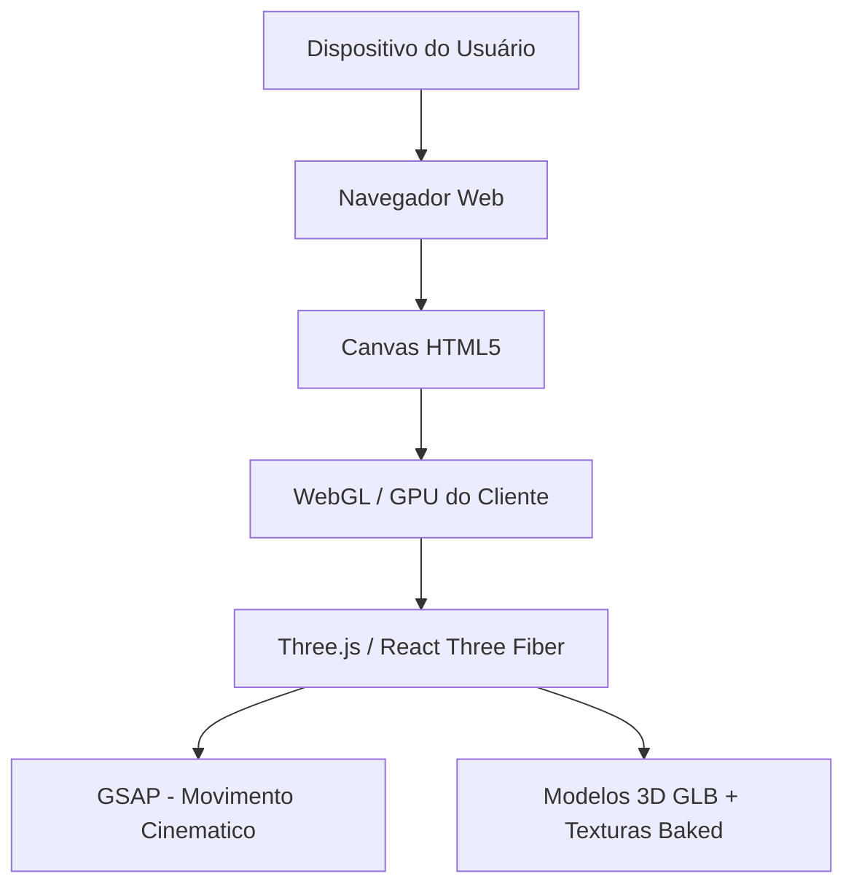

# Guia Técnico: Galeria 3D Imersiva para Portfólio (Tour Virtual)

Este guia desconstrói a arquitetura, o fluxo de otimização de assets e a lógica de programação necessários para construir uma **galeria 3D imersiva (sala de exposição virtual)** focada em performance e estética premium.

---

## 1. Arquitetura e Stack de Tecnologias

Para que a experiência seja fluida em qualquer dispositivo (incluindo celulares intermediários), estruturamos a aplicação dividindo as responsabilidades de processamento:



### Por que Three.js + GSAP?
1. **WebGL Nativo**: A GPU do cliente realiza todo o trabalho pesado de renderização (cálculo de pixels, projeção de perspectiva, texturização).
2. **Three.js**: Abstrai as complexas equações matemáticas e matrizes do WebGL, permitindo gerenciar objetos, câmeras e materiais.
3. **GSAP (GreenSock)**: Garante transições de câmera fluidas e controle dinâmico da interpolação (easing), evitando enjoo de movimento (motion sickness) no usuário.

---

## 2. O Pipeline de Assets 3D (O Segredo da Performance)

Como apontado na análise do projeto da *Snowflake Productions*, o visual realista de um site 3D premium não vem de luzes dinâmicas calculadas em tempo real (que exigiriam muito da GPU), mas de **ilusionismo técnico**.

### Passo 1: Modelagem e Otimização no Blender/C4D
* **Low-Poly**: A sala e os quadros devem ser modelados com a menor contagem de polígonos possível. Detalhes geométricos irrelevantes são removidos.
* **UV Unwrapping**: Mapear as coordenadas da malha 3D de forma limpa e sem sobreposição para receber as texturas.

### Passo 2: Texture Baking (Cozimento de Texturas)
* Toda a iluminação (luz direta, oclusão de ambiente - AO, sombras projetadas, rebatimento de cores) é renderizada no Blender usando o motor **Cycles** e salva diretamente em arquivos de imagem (texturas).
* O material aplicado no Three.js será do tipo **Basic** ou um **Standard** com `metalness: 0` e `roughness: 1`, usando a imagem baked como `map` (albedo/emissive). Assim, a placa de vídeo apenas exibe uma imagem estática "esticada" no objeto, simulando iluminação fotorrealista em tempo real a custo zero de renderização de luz.

### Passo 3: Compressão e Exportação
* O modelo é exportado em formato `.glb`.
* Aplica-se a compressão **Draco** (via ferramentas como `gltf-pipeline`), que reduz o tamanho geométrico do arquivo em até 80%, acelerando o download inicial do site.

---

## 3. Estrutura de Código Base (Exemplo Prático)

Abaixo está o esqueleto de código utilizando **Three.js (Vanilla)** para carregar a sala virtual e programar a movimentação suave da câmera para focar em um quadro ao ser clicado.

```javascript
import * as THREE from 'three';
import { GLTFLoader } from 'three/examples/jsm/loaders/GLTFLoader.js';
import { DRACOLoader } from 'three/examples/jsm/loaders/DRACOLoader.js';
import { OrbitControls } from 'three/examples/jsm/controls/OrbitControls.js';
import gsap from 'gsap';

// 1. Configuração da Cena, Câmera e Renderizador
const canvas = document.querySelector('#webgl-canvas');
const scene = new THREE.Scene();

const camera = new THREE.PerspectiveCamera(60, window.innerWidth / window.innerHeight, 0.1, 100);
camera.position.set(0, 1.6, 5); // Altura média dos olhos humanos (1.6m)

const renderer = new THREE.WebGLRenderer({ canvas, antialias: true, alpha: false });
renderer.setSize(window.innerWidth, window.innerHeight);
renderer.setPixelRatio(Math.min(window.devicePixelRatio, 2)); // Limitador de performance para telas Retina
renderer.toneMapping = THREE.ACESFilmicToneMapping; // Melhora o contraste e cores das texturas baked

// 2. Loader de Modelos 3D (Com Draco)
const dracoLoader = new DRACOLoader();
dracoLoader.setDecoderPath('/draco/'); // Caminho para os decodificadores do Google Draco

const gltfLoader = new GLTFLoader();
gltfLoader.setDRACOLoader(dracoLoader);

let galleryScene;
const interactableFrames = [];

gltfLoader.load('assets/gallery_room.glb', (gltf) => {
  galleryScene = gltf.scene;
  scene.add(galleryScene);

  // Mapear os materiais baked e identificar os quadros interativos
  galleryScene.traverse((child) => {
    if (child.isMesh) {
      // Usar MeshBasicMaterial para texturas baked (alta performance, ignora luzes dinâmicas)
      if (child.material.map) {
        child.material = new THREE.MeshBasicMaterial({ map: child.material.map });
      }

      // Se o objeto for um quadro interativo (identificado no Blender pelo nome)
      if (child.name.startsWith('Frame_')) {
        interactableFrames.push(child);
      }
    }
  });
});

// 3. Interatividade (Raycasting para cliques)
const raycaster = new THREE.Raycaster();
const mouse = new THREE.Vector2();

window.addEventListener('click', (event) => {
  mouse.x = (event.clientX / window.innerWidth) * 2 - 1;
  mouse.y = -(event.clientY / window.innerHeight) * 2 + 1;

  raycaster.setFromCamera(mouse, camera);
  const intersects = raycaster.intersectObjects(interactableFrames);

  if (intersects.length > 0) {
    const clickedFrame = intersects[0].object;
    focusOnFrame(clickedFrame);
  }
});

// 4. Animação de Câmera Suave com GSAP
function focusOnFrame(frame) {
  // Obtém a posição mundial do quadro
  const framePosition = new THREE.Vector3();
  frame.getWorldPosition(framePosition);

  // Calcula a posição ideal da câmera (ex: 2 metros à frente do quadro na direção normal)
  const targetCameraPos = framePosition.clone().add(new THREE.Vector3(0, 0, 2));

  // Anima a câmera até a nova posição
  gsap.to(camera.position, {
    x: targetCameraPos.x,
    y: targetCameraPos.y,
    z: targetCameraPos.z,
    duration: 1.8,
    ease: 'power3.inOut'
  });

  // Anima o ponto de foco da câmera para o centro do quadro
  gsap.to(controls.target, {
    x: framePosition.x,
    y: framePosition.y,
    z: framePosition.z,
    duration: 1.8,
    ease: 'power3.inOut',
    onUpdate: () => controls.update()
  });

  // Disparar UI 2D sobreposta (ex: exibir modal do case após a transição)
  showCaseDetails(frame.name);
}

// 5. Loop de Renderização (Game Loop)
const controls = new OrbitControls(camera, renderer.domElement);
controls.enableDamping = true; // Inércia suave na navegação manual
controls.dampingFactor = 0.05;

const tick = () => {
  controls.update();
  renderer.render(scene, camera);
  window.requestAnimationFrame(tick);
};
tick();
```

---

## 4. Estratégias de Otimização Críticas

1. **Draw Call Batching**: Se a galeria tiver quadros repetidos ou elementos repetitivos (luminárias, pilares), agrupamos usando `InstancedMesh`. Isso faz com que a GPU desenhe múltiplos objetos idênticos em uma única chamada.
2. **Frustum Culling**: Ativado por padrão no Three.js. Objetos fora da visão da câmera não são processados pela placa de vídeo.
3. **Texture Atlasing**: Agrupar as texturas dos quadros e da sala em poucas imagens grandes de resolução otimizada (ex: 2K para a sala inteira + texturas separadas apenas para os cases detalhados dos quadros).
4. **Resoluções Dinâmicas**: Detectar a capacidade da máquina do usuário e reduzir a qualidade do antialiasing ou a escala do renderizador para dispositivos móveis lentos.

---

> [!TIP]
> **Recomendação de Prática**: 
> Se o cliente já possui tours virtuais feitos em plataformas como Matterport ou imagens 360°, podemos criar transições dinâmicas onde clicar em um "quadro" na galeria 3D expande a imagem para uma visualização em 360 graus imersiva (Skybox/Equirectangular) sem sair do site, criando um fluxo híbrido e extremamente premium.
